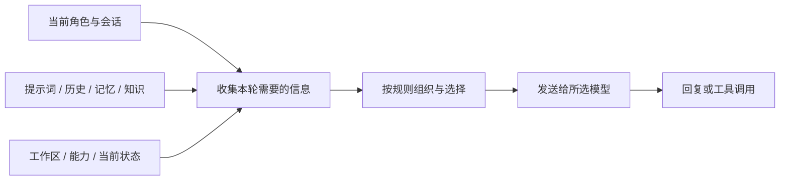

# 上下文编译

每次与伙伴对话时，**上下文编译**会在发送请求前，按当前角色、会话和设置，为模型整理本次需要的信息。

你可以把它想成出发前整理的随身包：伙伴带上当前问题，再从聊天记录、记忆和文件中挑选合适的资料。

本文主要介绍主应用中的桌面对话和据点群聊。社交应用有自己的上下文编译流程和设置。

## 一次对话怎样准备上下文？

1. **确认角色和会话**：读取当前会话及其设置，选择本轮使用的模型，并固定已发布的提示词版本。
2. **收集资料**：读取近期对话、角色设定和当前输入；按设置查找记忆、知识与其他需要的内容。
3. **组织和选择**：提示词框架安排消息，编译器按来源、优先级和预算选择需要的上下文，并生成一份编译清单。
4. **交给模型**：模型根据收到的内容回复，也可能请求使用工具。工具结果可在本轮后续调用中继续提供给模型。

这是一轮对话的概览。下表列出可能用到的资料，具体内容会随角色、场景、工具权限、模型和设置变化。

## 上下文从哪里来？

| 内容 | 来源和作用 |
| --- | --- |
| **角色和用户设定** | 角色人设、对你的称呼，以及「系统设定」中的用户人设等。实际使用哪些内容由框架和场景决定。 |
| **提示词框架** | 组织规则、角色信息和消息顺序。编译使用开始时已发布的版本；草稿发布后供后续编译使用。 |
| **本次输入与近期对话** | 当前消息和当前会话中选取的历史；附件是否以原始媒体或其他形式提供，取决于内容和模型能力等条件。 |
| **长期记忆** | 在允许自动召回时，根据本次话题查找相关事件。召回结果还会补充时间轴末尾事件及命中事件的直接前驱。 |
| **知识和事实** | 可按设置自动召回相关文档摘要和有效事实；它们与事件记忆的自动召回分别管理。 |
| **工具与工作资料** | 根据角色、会话和交互模式提供可用工具信息；工作场景还可能包含用户提供的文件、终端或之前工具读取的资料。 |
| **状态和其他信息** | 根据场景和策略，可能包含时间、角色状态、当前计划，或同一角色在另一场景中的近期对话。 |

提示词框架负责组织部分资料，插件等提供者也可能按当前授权提供额外资料。编辑框架的操作见[提示词框架](/advanced/prompts)。

## 历史、记忆和知识有什么区别？

- **对话历史**是会话中已经发生的消息。当前请求会从中选取需要的内容。
- **长期记忆**是伙伴保存的事件记录，可以在后续对话中按话题召回。历史消息需要经过保存，才可能成为长期记忆。
- **知识库**中的文档、共享事实和角色的事件记忆各自管理，有各自的检索与设置。

除当前会话外，主应用还可能按策略补充同一角色在桌面对话和据点之间的近期交流。这些历史作为资料提供给模型，系统指令与工具权限仍由相应规则管理。

## 内容放不下时会怎样？

模型能接收的内容有长度限制。编译时会结合模型的输入预算和会话策略，按必需性、优先级等规则选择上下文区域；空白、过期、重复或超出预算的可选内容可能被省略。如果必需内容本身超过适用预算，编译可能失败。

伙伴使用工具继续工作时，模型还会收到工具调用和结果。如果输入变得过长，运行过程会整理本次模型输入窗口中较早的内容，原有会话记录继续保存。特别大的工具结果可能以引用方式保留，供后续分段读取。

长度统计是估算，不同模型服务的实际计算方式可能不同。界面显示的发送前估算基于当时已有的内容；记忆和知识自动召回完成后，实际发送内容可能有所变化。

## 编译清单是什么？

编译器会生成 **Manifest（编译清单）**，记录本轮使用的角色、会话、提示词版本、记忆命中数量，以及上下文区域的来源和选择结果等信息。部分区域会记录未选原因，例如内容为空、重复、过期或超出预算。

清单帮助理解编译过程，完整模型请求还会在后续环节组装。查看来源时，可以结合区域的选择结果了解哪些内容进入了本轮上下文。

## 在哪里调整？

### 历史、记忆、文档和事实

「最近对话轮数」和事件记忆的自动召回在「核心记忆」→「RAG 配置」中按「桌面对话」和「据点群聊」分别调整，步骤见[调整事件记忆召回](/companion/memory#调整事件记忆召回)。文档和事实的自动召回在「知识库」的对应页面中开关，默认关闭，说明见[文档知识库](/companion/memory#文档知识库)和[事实库](/companion/memory#事实库)。

### 模型与提示词

「模型配置」中可以编辑模型的「上下文窗口 Token」和「最大输出 Token」。请按模型服务商提供的信息填写；可用于输入的空间还需要为输出留出余量。

在「提示词」中可以预览和发布框架。框架预览使用示例历史与记忆；真实对话的内容会随当时的上下文变化。

## 常见疑问

**为什么伙伴没有想起某件事？**

那件事可能尚待保存为长期记忆，或者本次检索和上下文选择未包含它。先检查「核心记忆」中的内容和自动召回设置；必要时直接告诉伙伴相关背景。

**记忆召回失败会怎样？**

主对话会跳过本次失败的记忆注入并继续对话。相关记忆仍然保留，伙伴本轮的回复可能缺少这些参考。

**切换会话后，伙伴还能记住我吗？**

新会话有自己的对话历史；角色关联的长期记忆可以跨会话使用，但是否出现在本轮仍取决于设置、检索结果和上下文条件。

## 源码入口

- [上下文编译器](https://github.com/YoKONCy/infOS/blob/main/packages/backend/src/services/context/contextCompiler.ts)与[区域选择](https://github.com/YoKONCy/infOS/blob/main/packages/backend/src/services/context/contextRegionRuntime.ts)
- [对话准备与预算估算](https://github.com/YoKONCy/infOS/blob/main/packages/backend/src/services/conversation/conversationTurnService.ts)、[运行中的窗口整理](https://github.com/YoKONCy/infOS/blob/main/packages/backend/src/services/context/promptWindow.ts)
- [记忆召回](https://github.com/YoKONCy/infOS/blob/main/packages/backend/src/services/memory/eventMemoryService.ts)、[知识与事实召回](https://github.com/YoKONCy/infOS/blob/main/packages/backend/src/services/knowledge/knowledgeRecallService.ts)
- [社交应用的独立编译流程](https://github.com/YoKONCy/infOS/blob/main/packages/apps/social/runtime/compiler.ts)
