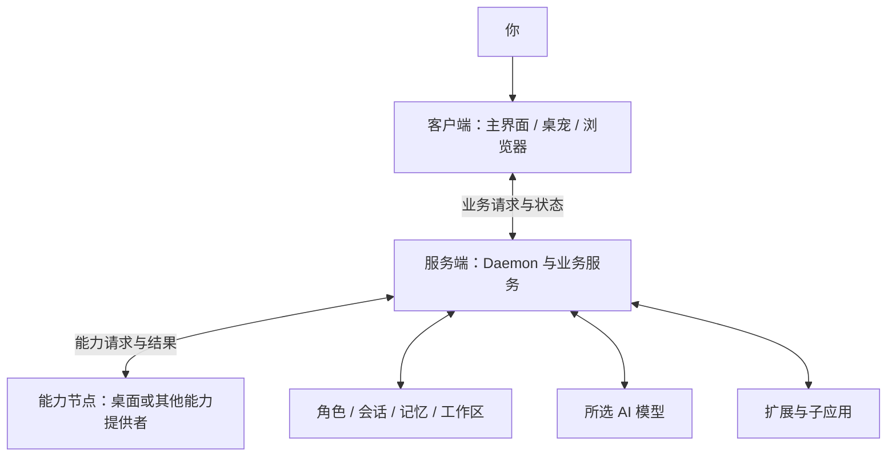

# AIOS 架构

infOS 是 PeroperoChat 背后的智能体运行系统。它把角色、对话、记忆、工作区和工具组织起来，让伙伴既能聊天，也能在允许的范围内完成任务。

这里的 AIOS 是运行在现有操作系统之上的**应用架构**。它通过逻辑内核协调资源、执行和能力；具体数据仍由各自的业务服务管理。

## 一张图了解整体结构

图中展示各部分的职责，它们可以运行在同一台设备上。例如，桌面客户端可以同时提供桌面能力；服务端也可以运行在这台电脑上。

## 角色关联的六类资源

每位伙伴都有自己的身份，也会使用记忆、工作区、会话和能力。这六类概念帮助我们理解它们的分工：

| 资源 | 作用 | 生命周期和范围 |
| --- | --- | --- |
| **身份（Identity）** | 伙伴是谁，包括角色人设、表达方式和场景补充。 | 随角色长期保存，可在「角色管理」中调整。 |
| **长期记忆（Memory）** | 保存伙伴值得记住的事件，供后续对话查找。 | 与角色关联，可以跨会话使用；共享事实和文档知识另有自己的管理方式。 |
| **工作区（Workspace）** | 存放伙伴工作时使用和产生的文件。 | 每个角色有自己的工作区，也可按授权使用其他工作目录。 |
| **上下文（Context）** | 为当前模型调用整理角色、历史、记忆和其他相关信息。 | 按本次请求编译和使用；长期记忆与聊天记录各自保存。 |
| **会话（Thread）** | 保存一个话题中的消息及相关设置。 | 一个角色可以有多个会话；桌宠和主界面可以接续同一会话。 |
| **工具能力（Capability）** | 定义伙伴可以使用哪些工具，以及适用的范围和约束。 | 受角色、场景、会话设置及执行时的权限检查共同影响。 |

这六类是理解角色运行方式的**资源视角**，由各自的服务和存储管理。内核对象注册表则有自己的对象类型清单，用于跨模块引用。

## 客户端、服务端和能力节点

| 职责 | 主要工作 | 例子 |
| --- | --- | --- |
| **客户端** | 展示页面，接收你的输入、审批和操作，并显示结果。 | Electron 主界面与桌宠、浏览器页面 |
| **服务端** | 管理业务数据、会话、上下文编译、模型调用与任务；协调可用能力。 | 本机或服务器上的 infOS Daemon |
| **能力节点** | 向服务端提供所在设备或进程拥有的具体能力。 | Electron 提供桌面、浏览器和音频等能力；独立 Node Host 可提供已注册的能力 |

同一个进程可以同时承担多个职责。以远程连接为例：Daemon 留在服务器上管理业务数据；你电脑上的 Electron 客户端显示界面，也可以在连接和授权允许时提供本机能力。依赖能力节点的操作需要节点在线并满足相应要求；客户端连接与具体能力授权分别管理。

业务请求通过 HTTP、SSE 或 WebSocket 等通道传递；Electron 的窗口、托盘等本机操作还使用 IPC。能力提供者与服务端之间另有能力连接，用于注册能力、接收调用和返回结果。

### 不同启动方式

- **桌面客户端的本地模式**：客户端启动并连接本机服务，同时可提供本机能力。
- **桌面客户端的远程模式**：客户端连接所选服务器上的业务服务；本机能力是否可用取决于连接与配置。
- **Docker**：服务运行在容器中，用户通过浏览器或已配置的客户端连接。桌面能力由接入的能力提供者按连接与配置提供。

当前以单个服务端管理一套业务数据、多个客户端或能力节点接入为主要使用方式。节点接入用于连接客户端和能力提供者；服务端之间的数据同步是另一项工作。

## 逻辑内核提供什么？

内核为跨模块协作提供一套共同的身份和边界，业务数据由各自的服务和存储管理。

### 对象与所有权

**内核对象引用（Kernel Object Ref）** 记录对象类型、标识、所属主体和代次，用于在边界间定位对象。对象注册表通过适配器读取领域数据，并检查所有者及代次；具体数据仍由原来的服务和存储负责。

当前注册的例子包括会话、后台任务、执行、节点、资产和传输，以及应用实例、模型配置和部分界面投影。这份清单与上面的六类资源视角用途不同。

### 执行与调度

内核用主体（Principal）标识行动的归属，例如某个角色或应用；用 Process 标识逻辑运行单元，用 Execution 标识一次具体执行。Process 表示内核层面的逻辑身份，与操作系统进程各有自己的用途。

Execution 可以关联主体、会话或任务，并携带截止时间和资源预算。运行状态可以是排队、运行、等待、完成、失败或取消等。

**调度器**管理需要排队的执行和周期工作。主对话和后台任务都可以关联执行身份，再由各自的流程负责保存结果和处理失败。

### 能力、提供者与授权

能力目录把几个概念分开：

1. **能力定义**说明一种能力有哪些操作。
2. **能力提供（Offer）** 说明哪个提供者当前能提供这些操作，以及它的状态和位置。
3. **能力需求（Requirement）** 说明调用方需要什么。
4. **能力句柄（Handle）** 限定主体能对哪个对象执行哪些操作，并可设置有效期或撤销。

绑定能力时，系统会根据需求和提供者的状态等条件选择可用项；调用时还会检查绑定与句柄。工具展示与执行授权是两个环节，工具调用需要经过相应的会话、权限和审批规则。

### 节点与连接

节点（Node）有稳定身份，可以声明服务端、客户端、能力提供者等一种或多种职责。节点会话（Node Session）表示一次连接，重连后会产生新的连接代次；节点在线且租约有效时，其能力可供调用。

部分需要用户参与的操作还使用 **Input Seat** 表示当前可接收输入或审批的客户端位置。这些抽象用于协调身份、连接和投递；各设备提供的功能取决于其环境、连接和配置。

### 事件与消息

执行状态和业务变化可以通过事件传递；需要持久处理的事件有相应的存储与发布流程。跨边界消息可以携带主体、执行、目标对象、操作和关联标识，帮助接收方理解请求来自哪里。

## 一次对话如何经过这些部分？

1. 客户端向服务端发送消息，指定当前角色和会话。
2. 服务端根据会话、角色和配置选择模型，并编译本轮上下文。上下文编译器会生成清单，记录所选信息及部分未选原因。
3. 模型生成回复；如果需要工具，执行器检查当前允许的能力和策略，必要时等待审批。
4. 工具或能力提供者返回结果，伙伴可以继续处理；通常的持久对话会保存消息与执行记录，再将结果展示给用户。

不同场景有各自的流程。比如社交应用使用独立的上下文编译流程；记忆召回和能力调用会按照对应场景与设置执行。

## 提示词和上下文的关系

提示词框架决定如何组织一部分发给模型的内容；上下文编译还会结合当前角色、会话和实际可用的信息，按场景、框架与设置选择本轮需要的资料。有关编译过程，请看[上下文编译](/core-systems/context)；有关编辑和发布，请看[提示词框架](/core-systems/mdp)。

## 当前边界与源码入口

执行策略和审批提供受管理的软件边界；当前本地执行器的隔离范围以这些软件策略为准，操作系统级强沙箱需要额外支持。跨节点能力也需要对应提供者在线、连接可用并满足授权条件。

想继续阅读实现，可以从以下入口开始：

- [内核协议与对象引用](https://github.com/YoKONCy/infOS/blob/main/packages/shared/src/types/kernel.types.ts)、[节点协议](https://github.com/YoKONCy/infOS/blob/main/packages/shared/src/types/node.types.ts)
- [对象注册表](https://github.com/YoKONCy/infOS/blob/main/packages/backend/src/kernel/kernelObjectRegistry.ts)、[执行运行时](https://github.com/YoKONCy/infOS/blob/main/packages/backend/src/kernel/executionRuntime.ts)、[能力目录](https://github.com/YoKONCy/infOS/blob/main/packages/backend/src/kernel/capabilityDirectory.ts)
- [上下文编译器](https://github.com/YoKONCy/infOS/blob/main/packages/backend/src/services/context/contextCompiler.ts)、[工具执行器](https://github.com/YoKONCy/infOS/blob/main/packages/backend/src/services/agent/toolExecutor.ts)
- [Electron 能力提供者](https://github.com/YoKONCy/infOS/blob/main/electron/main/services/capabilityProvider.ts)、[能力连接](https://github.com/YoKONCy/infOS/blob/main/packages/backend/src/capabilities/capabilityBridge.ts)
