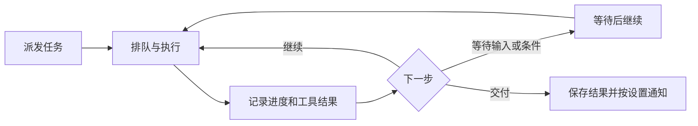

# 工作区与任务

工作区是你和伙伴一起查看、编辑文件的地方；任务让伙伴围绕一个目标持续工作，并记录进度和结果。你可以在工作区里协作，也可以把需要一段时间的工作交给后台任务。

对话和工作区的界面操作见[对话与工作区](/peripheral-systems/conversation-workspace)。

## 工作区是什么？

每位伙伴都有自己的工作区，用来存放工作文件。工作区属于角色：同一角色的多个会话可以使用这份文件，不同角色各有自己的工作区。对话历史则按会话保存。

工作区文件保存在**服务端所在的设备**上。桌面客户端连接本机服务时，文件在本机；连接远程服务时，工作区位于远程服务端。Docker 部署时，文件位于服务端的数据目录中，持久保存还取决于容器的数据挂载配置。

伙伴也可以按工具权限和执行策略访问其他位置。文件操作、终端命令和审批的范围见[工具与能力](/core-systems/tools#权限门禁如何工作)。

## 在工作区协作

打开左侧「工作区」，页面围绕当前伙伴和会话组织：

| 区域 | 可以做什么 |
| --- | --- |
| **资源栏** | 在「文件」中浏览工作区，在「搜索」中查找文件内容；也可以对文件或文件夹重命名、删除。 |
| **中间编辑区** | 打开文件、查看预览，编辑并保存支持的文本；Markdown 可以切换「编辑」和「浏览」。 |
| **终端** | 查看和操作工作终端，按需要展开、收起或最大化。 |
| **协作栏** | 与伙伴沟通、查看会话内容和待处理的交互；点击顶部伙伴区域可以切换会话或新建会话。 |

选中文本后，点击「引用选区」可以把选区加入本轮材料，再向伙伴说明希望如何处理。文件由你或伙伴修改后，工作区会显示相应内容；保存时如果文件已被外部修改，界面会提示你处理冲突。

图片、PDF 等文件可在支持的格式下预览。较大的文本文件和部分搜索结果以只读方式展示。删除操作会要求确认；删除文件夹时，其中的文件也会一并删除。

桌面客户端连接本机服务时，资源栏提供「在系统文件管理器中打开工作区」入口。远程服务和浏览器访问时，可以继续通过页面浏览服务端工作区。

## 工作区文件如何恢复？

对话中撤回某一轮时，系统会尝试恢复该轮及之后由 `write_file`、`edit_file` 记录的工作区文件改动。恢复前会检查文件的修改记录和当前内容；发现后续人工或外部修改、记录缺失等情况时，会保留受影响文件并在界面说明。

终端、外部程序和后台任务造成的改动，以及工作区外写入、删除和重命名，目前缺少完整的自动恢复记录。处理重要文件前，保留自己的备份会更稳妥。

## 后台任务怎样工作？

任务可以由你在任务中心派发，也可以从对话、定时安排等入口创建。任务绑定执行伙伴，并有自己的后台会话、目标和状态；它使用该角色的工作区和适用工具，完成后按设置交付结果。

普通会话和后台任务各有自己的执行会话，用来管理执行身份和终端等运行资源；属于同一角色的执行会话仍可使用该角色的工作区文件。因此，你在工作区里看到的文件可能随伙伴的后台工作而更新。

任务执行可以分成多段。系统保存目标、进度、交接信息、工具记录和结果；需要等待时间、关联任务、你的回答或审批时，任务会进入相应等待状态。执行段数、模型调用和工具调用有累计上限，达到上限后可以在任务详情中检查并调整。

后台任务的工具调用遵循角色、场景、执行权限与审批规则。它逐项调用工具并记录执行检查点；每次具体操作仍以工具返回结果为准。

## 派发和查看任务

1. 打开左侧「任务中心」，点击「派发新任务」。
2. 选择「执行角色」，填写「任务指令」；也可以填写标题和完成条件。
3. 根据任务选择完成后行为，点击「交给 TA」。

完成后行为包括「任务中心通知」「自动打开结果」和「发送到当前对话」。选择发送到当前对话时，需要有可投递的当前会话。任务中心创建任务时可以选择其他伙伴；目标和完成条件写得越具体，伙伴越容易判断何时交付。

表单中的「仅查询与读取，服务重启后可自动继续」适合查询类任务。选中后，任务的工具调用受只读范围限制；服务恢复时，符合恢复条件的只读任务会重新排队继续。任务详情中也可以调整这一设置。

「进行中」展示当前任务及其状态；点击任务可以查看「概览」「执行记录」和「运行信息」。已完成、失败或取消的任务可在「历史记录」中查看。任务卡片会根据状态提供暂停、恢复、取消等操作；任务详情还可查看计划、结果依据、产出和投递状态。

### 常见状态

| 状态 | 含义 |
| --- | --- |
| **排队中 / 运行中** | 等待调度或正在执行。 |
| **等待输入** | 等待你的回答或审批。 |
| **等待条件** | 等待约定时间或关联任务等条件。 |
| **已暂停 / 需要处理** | 任务暂时停下；打开详情查看原因及可用操作。 |
| **已完成 / 失败 / 已取消** | 本次任务已结束，可在历史记录查看结果或原因。 |

「已完成」表示任务已经交付；详情中的「结果依据」会说明执行器是否提供了可查的工具记录。查看结果和依据可以帮助你判断任务是否满足自己的要求。

## 中断后怎样继续？

服务重启后，系统会恢复任务记录。处于等待回答或审批的任务会保留待处理事项；符合条件的只读任务可以自动继续。其他中断的任务会等待检查现场，再由你决定是否继续。

如果某个操作的执行结果尚待核验，任务详情会显示「我已核验……的执行结果」。请先检查实际文件或目标状态，确认后勾选并点击「继续任务」，让伙伴接着处理。任务详情中的「调整任务」还可以修改要求、完成条件、截止时间和执行上限。

结果投递也有自己的状态。看到「送达待核验」时，可以先检查目标位置，再选择「已送达」或「确认未送达，重发」。

## 定时任务与提醒

在「任务中心」打开「定时与提醒」，展开「安排稍后的任务」，选择伙伴、执行时间、结果会话、重复安排并填写任务内容，然后点击「创建任务」。到达时间后，系统会派发后台任务；重复安排可以选择每小时、每 24 小时或每 7 天。

所选会话用于结果投递和确定任务的部分工具设置。派发时，同一角色、同一场景的有效来源会话会提供执行权限和工具开关；极简模式保持极简，其他模式的后台任务使用工作模式。你也可以让伙伴在对话中设置提醒；任务中心会展示待触发的提醒和系统后台任务状态。

## 计划、任务和工作区的关系

伙伴可以在会话中用行动计划组织步骤，并把合适的步骤关联到后台任务或定时安排。计划展示要做的事和步骤状态；后台任务负责执行与交付；工作区保存使用或产生的文件。一个任务也可以只做查询并返回文字结果。

## 源码入口

- [工作区服务](https://github.com/YoKONCy/infOS/blob/main/packages/backend/src/services/workspace/workspaceService.ts)、[工作区文件运行时](https://github.com/YoKONCy/infOS/blob/main/packages/backend/src/services/execution/virtualWorkspace.ts)、[文件恢复记录](https://github.com/YoKONCy/infOS/blob/main/packages/backend/src/services/workspace/workspaceCheckpointService.ts)
- [后台任务调度](https://github.com/YoKONCy/infOS/blob/main/packages/backend/src/services/task/backgroundTaskService.ts)、[任务生命周期](https://github.com/YoKONCy/infOS/blob/main/packages/backend/src/services/task/taskLifecycle.ts)、[结果投递](https://github.com/YoKONCy/infOS/blob/main/packages/backend/src/services/task/taskDeliveryService.ts)
- [行动计划](https://github.com/YoKONCy/infOS/blob/main/packages/backend/src/services/task/taskPlanService.ts)、[定时调度](https://github.com/YoKONCy/infOS/blob/main/packages/backend/src/services/scheduler/schedulerService.ts)
- [工作区界面](https://github.com/YoKONCy/infOS/blob/main/packages/frontend/src/components/main/tabs/WorkspaceTab.vue)、[任务中心](https://github.com/YoKONCy/infOS/blob/main/packages/frontend/src/components/dashboard/tabs/TasksTab.vue)
